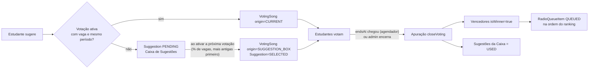

# Modelo de dados e contratos da API

Este documento é a **referência** que as issues seguem. Se você for criar um model, uma rota ou um tipo no frontend, use exatamente os nomes daqui. Se achar que algo precisa mudar, comente na issue e fale com o Tech Lead antes — frontend e backend dependem destes nomes.

> Requisitos completos: [`docs/requisitos.md`](requisitos.md)

## Decisões do projeto

| Tema | Decisão |
|---|---|
| Voto repetido | **Liberado nesta fase** (foco em engajamento). O navegador gera um `voterToken` anônimo (`crypto.randomUUID()` no `localStorage`) que é gravado só para estatística. Nenhum IP é guardado. Login de estudante fica para o futuro (#100). |
| Áudio das músicas | Link do **YouTube**. Guardamos o `youtubeVideoId` (11 caracteres) e a rádio toca com a YouTube IFrame Player API. |
| Vinhetas | Arquivos de áudio enviados pelo admin (mp3/wav/ogg), servidos pelo backend em `/uploads/`. |
| Quem escolhe as músicas | **Só os estudantes** (RN016, RN017). O admin configura regras; o sistema seleciona da Caixa por ordem de chegada (FIFO). Não existe rota para colocar música direto na rádio (RN013). |

## Entidades

Convenções: tabelas em snake_case plural com `@@map`; todo model tem `id Int @id @default(autoincrement())` e `createdAt DateTime @default(now())`.

```prisma
enum Role            { ADMIN COMMON }
enum VotingType      { SINGLE PLAYLIST }
enum VotingStatus    { SCHEDULED ACTIVE CLOSED }
enum Period          { MORNING NIGHT }
enum SongOrigin      { CURRENT SUGGESTION_BOX }
enum SuggestionStatus{ PENDING SELECTED REJECTED USED }
enum QueueStatus     { QUEUED PLAYING PLAYED SKIPPED }
enum JingleCategory  { EVENTS ANNOUNCEMENTS INSTITUTIONAL NOTICES }

model User {            // users
  name, email (@unique), passwordHash, role (default COMMON), blocked (default false), updatedAt
}

model Song {            // songs
  title, artist?, youtubeUrl?, youtubeVideoId? (@unique), updatedAt
}

model Voting {          // votings
  title, description?, startsAt, endsAt,
  maxSongs, votesPerVoter, type, winnersCount,
  suggestionBoxPercent (0–100), period? (null = qualquer período),
  status (default SCHEDULED), closedAt?, createdById -> User, updatedAt
}

model VotingSong {      // voting_songs   @@unique([votingId, songId])
  votingId -> Voting (cascade), songId -> Song, origin,
  votesCount (default 0, preenchido na apuração), rank?, isWinner (default false)
}

model Vote {            // votes
  votingId -> Voting (cascade), votingSongId -> VotingSong (cascade), voterToken
}

model Suggestion {      // suggestions    @@index([status, period, createdAt])
  title, artist?, youtubeUrl, youtubeVideoId, period,
  status (default PENDING), votingId? -> Voting, updatedAt
}

model RadioQueueItem {  // radio_queue    @@index([status, position])
  songId -> Song, votingId -> Voting (obrigatório!), position, status (default QUEUED), playedAt?
}

model Jingle {          // jingles
  name, category, filePath, mimeType, durationSeconds?, updatedAt
}

model AuditLog {        // audit_logs
  userId? -> User, action, entity, entityId?, payload Json?
}
```

### Ações de auditoria (`AuditLog.action`)
`VOTING_CREATED`, `VOTING_UPDATED`, `VOTING_DUPLICATED`, `VOTING_CLOSED`, `VOTING_DELETED`, `USER_CREATED`, `USER_UPDATED`, `USER_BLOCKED`, `USER_UNBLOCKED`, `USER_DELETED`, `SUGGESTION_REJECTED`, `SUGGESTION_USED`, `SUGGESTION_DELETED`, `SUGGESTION_BOX_CLEARED`, `RADIO_STARTED`, `RADIO_NEXT`, `RADIO_PREVIOUS`, `JINGLE_CREATED`, `JINGLE_UPDATED`, `JINGLE_DELETED`.

## Fluxos principais



- **Ciclo de vida da votação:** `SCHEDULED` → (agendador, `startsAt`) → `ACTIVE` → (agendador, `endsAt`, ou admin) → `CLOSED`.
- **RN001:** duas votações `SCHEDULED`/`ACTIVE` não podem ter períodos sobrepostos — validado na criação/edição.
- **Vagas:** `freeSlots = maxSongs − quantidade de VotingSong`. Na ativação, `floor(maxSongs × suggestionBoxPercent / 100)` vagas são preenchidas com a Caixa; se faltar sugestão, as vagas sobram para o período atual.
- **Apuração:** mais votos primeiro; empate → música que entrou antes. Vencedores = `winnersCount` primeiros **com pelo menos 1 voto**.

## Contratos da API

Erros sempre no formato `{ "message": "texto em português" }`. Rotas `/admin/*` exigem token de ADMIN; rotas da rádio e `/auth/me` exigem token de qualquer usuário (`Authorization: Bearer <token>`).

### Público (visitante)
| Método | Rota | Body / Query | Resposta |
|---|---|---|---|
| GET | `/votings/active` | — | `200` `ActiveVoting` ou `200 null` |
| POST | `/votings/:id/votes` | `{ votingSongIds: number[], voterToken: string }` | `201 { registered }` · `400` · `409` (não ativa) |
| POST | `/suggestions` | `{ title, artist?, youtubeUrl, period: "MORNING"\|"NIGHT" }` | `201 { destination: "VOTING"\|"SUGGESTION_BOX" }` · `400` · `409` (duplicada) |
| GET | `/votings?page=` | — | `200 { items, page, total }` (só encerradas) |
| GET | `/votings/:id/results` | — | `200 VotingResult` · `409` (não encerrada) |

```ts
type ActiveVoting = {
  id: number; title: string; description: string | null
  type: 'SINGLE' | 'PLAYLIST'; votesPerVoter: number; maxSongs: number
  period: 'MORNING' | 'NIGHT' | null; startsAt: string; endsAt: string; freeSlots: number
  songs: { votingSongId: number; title: string; artist: string | null; youtubeVideoId: string | null; origin: 'CURRENT' | 'SUGGESTION_BOX' }[]
}

type VotingResult = {
  id: number; title: string; type: 'SINGLE' | 'PLAYLIST'; closedAt: string; totalVotes: number
  songs: { rank: number; title: string; artist: string | null; youtubeVideoId: string | null; votes: number; isWinner: boolean }[]
}
```

### Autenticação
| Método | Rota | Body | Resposta |
|---|---|---|---|
| POST | `/auth/login` | `{ email, password }` | `200 { token, user: { id, name, email, role } }` · `401` · `403` (bloqueado) |
| GET | `/auth/me` | — | `200 { id, name, email, role }` · `401` |

### Admin — votações
| Método | Rota | Observação |
|---|---|---|
| POST | `/admin/votings` | cria (`SCHEDULED`) |
| GET | `/admin/votings?status=&page=` | lista paginada |
| GET | `/admin/votings/:id` | detalhe com músicas |
| PUT | `/admin/votings/:id` | só `SCHEDULED` |
| DELETE | `/admin/votings/:id` | só `SCHEDULED` · `204` |
| POST | `/admin/votings/:id/duplicate` | body `{ title, startsAt, endsAt }` |
| POST | `/admin/votings/:id/close` | só `ACTIVE` |

### Admin — Caixa de Sugestões
| Método | Rota | Observação |
|---|---|---|
| GET | `/admin/suggestions?status=&period=&page=` | mais antigas primeiro |
| PATCH | `/admin/suggestions/:id` | `{ status: "REJECTED"\|"USED" }` |
| DELETE | `/admin/suggestions/:id` | não remove `SELECTED` |
| DELETE | `/admin/suggestions?status=PENDING` | limpar fila → `{ removed }` |

### Admin — usuários
`POST /admin/users` · `GET /admin/users?page=&search=` · `PUT /admin/users/:id` · `PATCH /admin/users/:id/block` (`{ blocked }`) · `DELETE /admin/users/:id`

### Rádio (usuário logado)
| Método | Rota | Observação |
|---|---|---|
| GET | `/radio/timeline` | `{ current, next, upcoming[], history[] }` |
| POST | `/radio/start` | primeiro da fila vira `PLAYING` |
| POST | `/radio/next` | body opcional `{ finished: true }` |
| POST | `/radio/previous` | volta a anterior |

### Vinhetas, auditoria e dashboard
`POST /admin/jingles` (multipart) · `GET /jingles?category=` · `PUT /admin/jingles/:id` · `DELETE /admin/jingles/:id` · `GET /admin/audit-logs?entity=&userId=&page=` · `GET /admin/dashboard`
