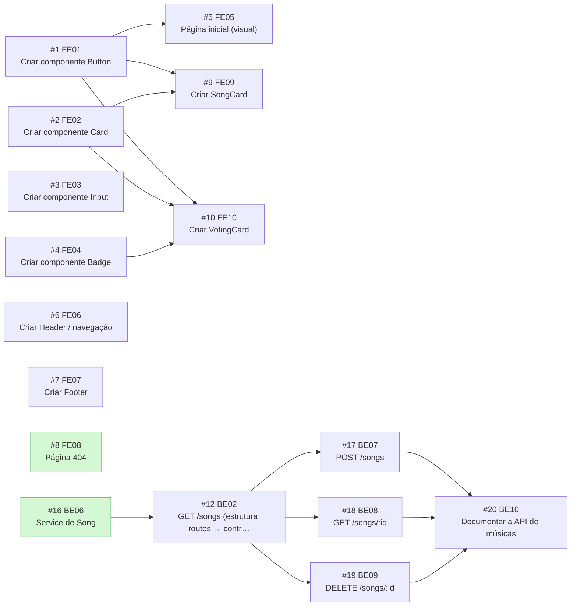
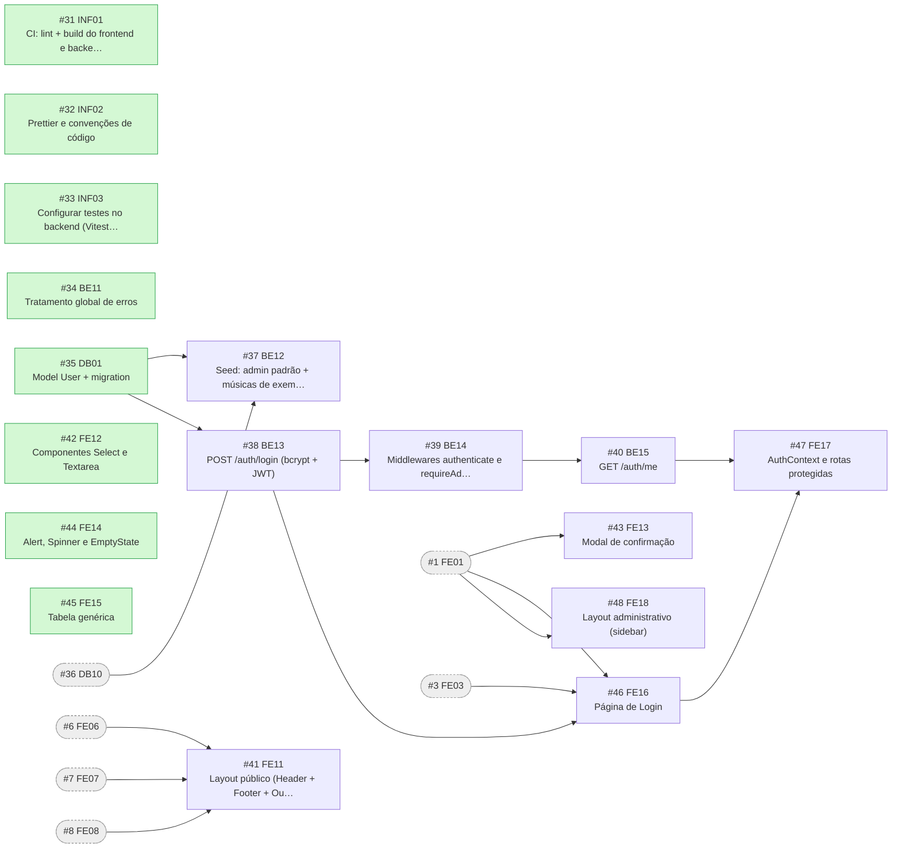
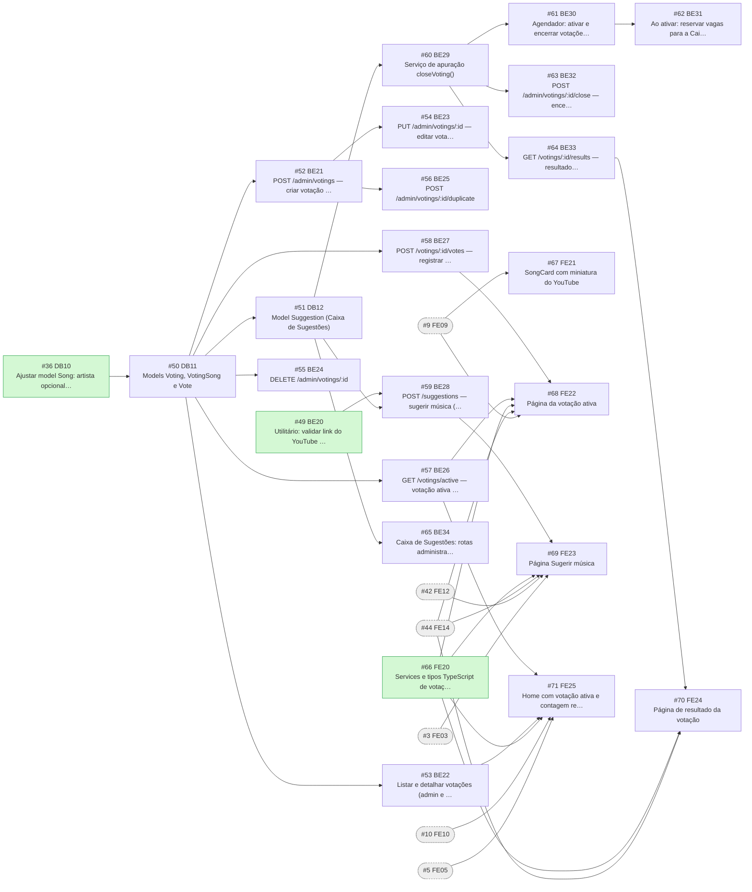
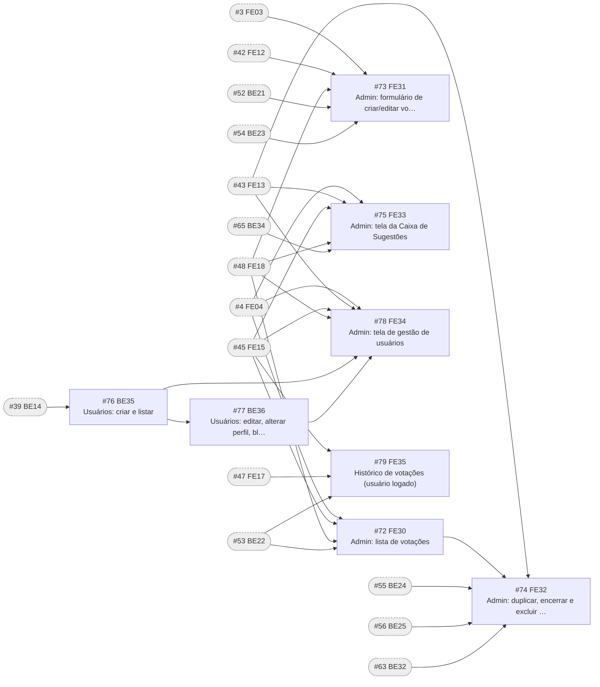
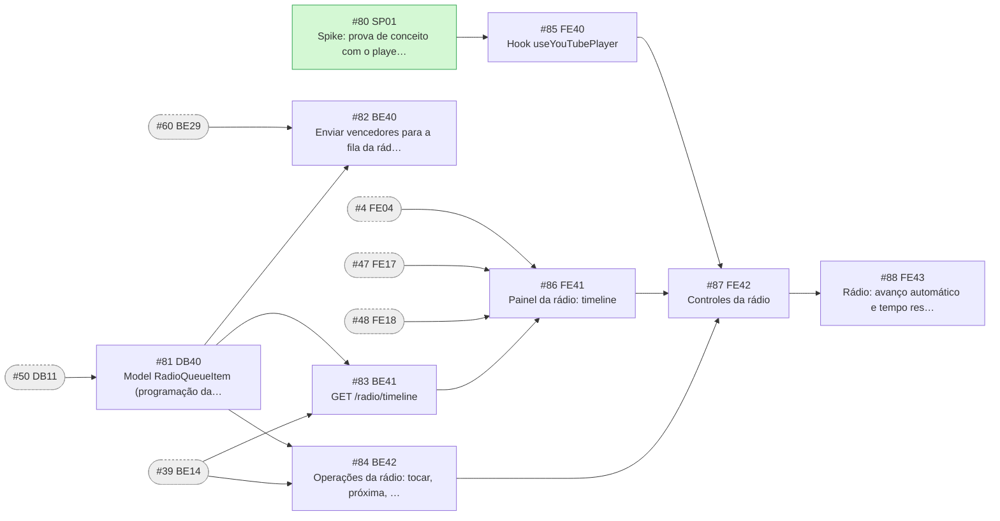
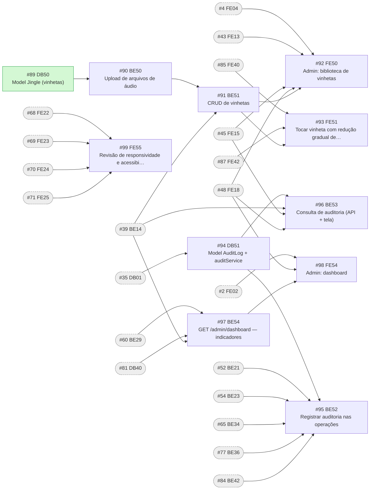

# Roadmap do IFPlay

Mapa de todas as tasks do projeto, por fase, com as dependências entre elas.

## Como escolher uma task

1. Vá em **Issues** e filtre pela label **`pronta`** — são as tasks sem dependência aberta, que você pode pegar agora.
2. Escolha pelo nível: 🟢 `nível 1 · fácil` (primeira task) · 🟡 `nível 2 · médio` · 🔴 `nível 3 · difícil`.
3. Issues com **`bloqueada`** dependem de outra que ainda não terminou. A seção **🔗 Dependências** da issue diz qual. Quando a dependência for mergeada, o Tech Lead troca a label para `pronta`.
4. Siga o [Fluxo de desenvolvimento](../FLUXO%20DE%20DESENVOLVIMENTO.MD): se atribua → comente → branch → PR com `Closes #N`.

Links rápidos: [tasks prontas](https://github.com/starkjr-ifpr/ifplay/issues?q=is%3Aopen+label%3Apronta) · [prontas e fáceis](https://github.com/starkjr-ifpr/ifplay/issues?q=is%3Aopen+label%3Apronta+label%3A%22n%C3%ADvel+1+%C2%B7+f%C3%A1cil%22) · [milestones](https://github.com/starkjr-ifpr/ifplay/milestones)

> Contratos de API e nomes de tabelas: [modelo-de-dados.md](modelo-de-dados.md)

## F0 Sprint 0

| Issue | Task | Nível | Depende de |
|---|---|---|---|
| #1 | `FE01` Criar componente Button | 🟢 | — |
| #2 | `FE02` Criar componente Card | 🟢 | — |
| #3 | `FE03` Criar componente Input | 🟢 | — |
| #4 | `FE04` Criar componente Badge | 🟢 | — |
| #5 | `FE05` Página inicial (visual) | 🟢 | #1 |
| #6 | `FE06` Criar Header / navegação | 🟢 | — |
| #7 | `FE07` Criar Footer | 🟢 | — |
| #8 | `FE08` Página 404 | 🟢 | — |
| #9 | `FE09` Criar SongCard | 🟢 | #1, #2 |
| #10 | `FE10` Criar VotingCard | 🟢 | #1, #2, #4 |
| #12 | `BE02` GET /songs (estrutura routes → controller → service) | 🟢 | #16 |
| #16 | `BE06` Service de Song | 🟢 | #15 |
| #17 | `BE07` POST /songs | 🟢 | #12 |
| #18 | `BE08` GET /songs/:id | 🟢 | #12 |
| #19 | `BE09` DELETE /songs/:id | 🟢 | #12 |
| #20 | `BE10` Documentar a API de músicas | 🟢 | #17, #18, #19 |

Verde = pronta no momento da criação · cinza tracejado = issue de outra fase.

## F1 Fundação

| Issue | Task | Nível | Depende de |
|---|---|---|---|
| #31 | `INF01` CI: lint + build do frontend e backend em todo PR | 🟡 | — |
| #32 | `INF02` Prettier e convenções de código | 🟢 | — |
| #33 | `INF03` Configurar testes no backend (Vitest) + primeiro teste | 🟡 | — |
| #34 | `BE11` Tratamento global de erros | 🟡 | — |
| #35 | `DB01` Model User + migration | 🟢 | — |
| #37 | `BE12` Seed: admin padrão + músicas de exemplo | 🟢 | #35, #36 |
| #38 | `BE13` POST /auth/login (bcrypt + JWT) | 🟡 | #35 |
| #39 | `BE14` Middlewares authenticate e requireAdmin | 🟡 | #38 |
| #40 | `BE15` GET /auth/me | 🟢 | #39 |
| #41 | `FE11` Layout público (Header + Footer + Outlet) e rotas | 🟢 | #6, #7, #8 |
| #42 | `FE12` Componentes Select e Textarea | 🟢 | — |
| #43 | `FE13` Modal de confirmação | 🟡 | #1 |
| #44 | `FE14` Alert, Spinner e EmptyState | 🟢 | — |
| #45 | `FE15` Tabela genérica | 🟢 | — |
| #46 | `FE16` Página de Login | 🟡 | #1, #3, #38 |
| #47 | `FE17` AuthContext e rotas protegidas | 🟡 | #46, #40 |
| #48 | `FE18` Layout administrativo (sidebar) | 🟢 | #1 |

Verde = pronta no momento da criação · cinza tracejado = issue de outra fase.

## F2 Votação & Sugestões

| Issue | Task | Nível | Depende de |
|---|---|---|---|
| #36 | `DB10` Ajustar model Song: artista opcional + link do YouTube | 🟢 | — |
| #49 | `BE20` Utilitário: validar link do YouTube e extrair o videoId | 🟢 | — |
| #50 | `DB11` Models Voting, VotingSong e Vote | 🟡 | #36 |
| #51 | `DB12` Model Suggestion (Caixa de Sugestões) | 🟢 | #50 |
| #52 | `BE21` POST /admin/votings — criar votação com regras de negócio | 🔴 | #50 |
| #53 | `BE22` Listar e detalhar votações (admin e histórico público) | 🟢 | #50 |
| #54 | `BE23` PUT /admin/votings/:id — editar votação | 🟡 | #52 |
| #55 | `BE24` DELETE /admin/votings/:id | 🟢 | #50 |
| #56 | `BE25` POST /admin/votings/:id/duplicate | 🟢 | #52 |
| #57 | `BE26` GET /votings/active — votação ativa (público) | 🟡 | #50 |
| #58 | `BE27` POST /votings/:id/votes — registrar votos | 🟡 | #50 |
| #59 | `BE28` POST /suggestions — sugerir música (votação atual ou Caixa) | 🔴 | #51, #49 |
| #60 | `BE29` Serviço de apuração closeVoting() | 🔴 | #51 |
| #61 | `BE30` Agendador: ativar e encerrar votações automaticamente | 🟡 | #60 |
| #62 | `BE31` Ao ativar: reservar vagas para a Caixa de Sugestões | 🔴 | #61 |
| #63 | `BE32` POST /admin/votings/:id/close — encerrar manualmente | 🟢 | #60 |
| #64 | `BE33` GET /votings/:id/results — resultado público | 🟢 | #60 |
| #65 | `BE34` Caixa de Sugestões: rotas administrativas | 🟡 | #51 |
| #66 | `FE20` Services e tipos TypeScript de votações e sugestões | 🟢 | — |
| #67 | `FE21` SongCard com miniatura do YouTube | 🟢 | #9 |
| #68 | `FE22` Página da votação ativa | 🟡 | #9, #44, #66, #57, #58 |
| #69 | `FE23` Página Sugerir música | 🟡 | #3, #42, #44, #66, #59 |
| #70 | `FE24` Página de resultado da votação | 🟡 | #44, #66, #64 |
| #71 | `FE25` Home com votação ativa e contagem regressiva | 🟡 | #5, #10, #66, #53, #57 |

Verde = pronta no momento da criação · cinza tracejado = issue de outra fase.

## F3 Painel Admin

| Issue | Task | Nível | Depende de |
|---|---|---|---|
| #72 | `FE30` Admin: lista de votações | 🟡 | #4, #45, #48, #53 |
| #73 | `FE31` Admin: formulário de criar/editar votação | 🔴 | #3, #42, #48, #52, #54 |
| #74 | `FE32` Admin: duplicar, encerrar e excluir votação | 🟡 | #43, #72, #55, #56, #63 |
| #75 | `FE33` Admin: tela da Caixa de Sugestões | 🟡 | #4, #43, #45, #48, #65 |
| #76 | `BE35` Usuários: criar e listar | 🟡 | #39 |
| #77 | `BE36` Usuários: editar, alterar perfil, bloquear e excluir | 🟡 | #76 |
| #78 | `FE34` Admin: tela de gestão de usuários | 🟡 | #4, #43, #45, #48, #76, #77 |
| #79 | `FE35` Histórico de votações (usuário logado) | 🟢 | #45, #47, #53 |

Verde = pronta no momento da criação · cinza tracejado = issue de outra fase.

## F4 Rádio

| Issue | Task | Nível | Depende de |
|---|---|---|---|
| #80 | `SP01` Spike: prova de conceito com o player do YouTube | 🟡 | — |
| #81 | `DB40` Model RadioQueueItem (programação da rádio) | 🟢 | #50 |
| #82 | `BE40` Enviar vencedores para a fila da rádio ao encerrar | 🟡 | #60, #81 |
| #83 | `BE41` GET /radio/timeline | 🟡 | #81, #39 |
| #84 | `BE42` Operações da rádio: tocar, próxima, anterior, terminou | 🟡 | #81, #39 |
| #85 | `FE40` Hook useYouTubePlayer | 🔴 | #80 |
| #86 | `FE41` Painel da rádio: timeline | 🟡 | #4, #47, #48, #83 |
| #87 | `FE42` Controles da rádio | 🔴 | #85, #86, #84 |
| #88 | `FE43` Rádio: avanço automático e tempo restante | 🟡 | #87 |

Verde = pronta no momento da criação · cinza tracejado = issue de outra fase.

## F5 Vinhetas, Auditoria & Dashboard

| Issue | Task | Nível | Depende de |
|---|---|---|---|
| #89 | `DB50` Model Jingle (vinhetas) | 🟢 | — |
| #90 | `BE50` Upload de arquivos de áudio | 🔴 | #89 |
| #91 | `BE51` CRUD de vinhetas | 🟡 | #90, #39 |
| #92 | `FE50` Admin: biblioteca de vinhetas | 🟡 | #4, #43, #45, #48, #91 |
| #93 | `FE51` Tocar vinheta com redução gradual de volume | 🔴 | #85, #87, #91 |
| #94 | `DB51` Model AuditLog + auditService | 🟡 | #35 |
| #95 | `BE52` Registrar auditoria nas operações | 🟡 | #94, #52, #54, #65, #77, #84 |
| #96 | `BE53` Consulta de auditoria (API + tela) | 🟢 | #94, #39, #45, #48 |
| #97 | `BE54` GET /admin/dashboard — indicadores | 🟡 | #60, #81, #39 |
| #98 | `FE54` Admin: dashboard | 🟡 | #2, #48, #97 |
| #99 | `FE55` Revisão de responsividade e acessibilidade das telas públicas | 🟢 | #68, #69, #70, #71 |

Verde = pronta no momento da criação · cinza tracejado = issue de outra fase.

## Futuro

| Issue | Task | Nível | Depende de |
|---|---|---|---|
| #100 | `FUT01` [Futuro] Login de estudante e 1 voto por aluno | 🔴 | — |
